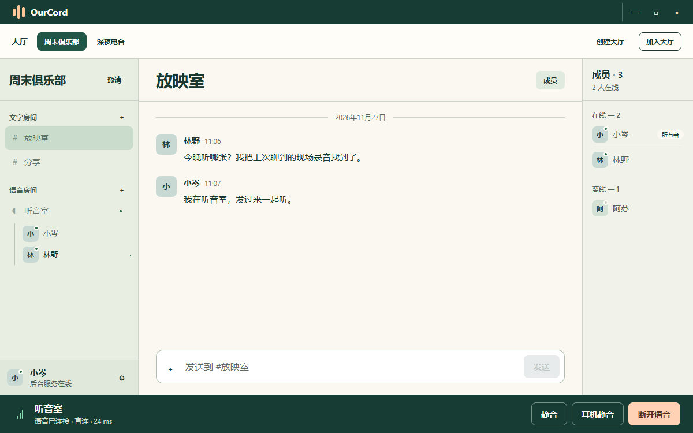

# OurCord 桌面客户端设计与实现

## Overview

首要任务是让 5–10 人的小群在通话时继续发消息、看附件和切换文字房间。当前文字房间显示在中央，实际连接的语音房间固定显示在底部。图中用户在「放映室」聊天，同时留在「听音室」通话。

**实现前的设计稿。** [可编辑 HTML 画板](studio.html) 包含聊天、登录和语音三个画面，可在浏览器中直接打开。[聊天与通话设计图](conversation.png) 保留了最初的 1200 × 750 画面。

**实现截图，1200 × 750。** 截自 Chromium 中运行的桌面前端构建产物。测试脚本模拟 Tauri IPC 返回值，画面中的成员、在线状态和直连延迟均为示例数据。在[最小窗口截图（920 × 620）](conversation-compact.png)中，成员清单初始收起，发送区和通话栏仍同时可见。

## Colors

暖白纸面承载消息，浅鼠尾草绿区分房间目录，墨绿连接窗口顶栏与通话底栏。品牌声纹使用杏色，断开按钮使用更浅的杏色 `#ffd2b5`。正在通话的房间有连接状态文字，正在发言的参与者有描边和文字提示。

## Typography

使用系统自带的无衬线字体和中文回退字体。房间标题为 29 px，登录标题为 35 px。消息正文为 15 px，行高 1.65，每行最多约 70 个拉丁字符宽。时间戳采用等宽数字方便对齐，辅助信息主要使用 12–13 px。

## Layout

大厅横向排列并显示名称，房间目录占据左栏，中间留给当前任务，右侧成员清单可收起。宽 1200 px 时，两侧栏分别占 240 px 和 192 px。宽度降至 1000 px 及以下时，房间目录缩至 184 px；宽度小于 1000 px 时启动，成员清单默认收起。用户可在房间标题旁打开成员清单。

顶栏高 42 px，大厅栏高 60 px。连接语音后，至少 66 px 高的通话栏横跨整个工作区。消息历史独立滚动，发送区紧贴其下。布局与色值见[实现样式表](../src/styles.css)。

## Components

下表记录各入口及其交互设计。

| 任务 | 入口与反馈 |
| --- | --- |
| 登录 | 左侧声纹图形与右侧邮箱表单分区。邮箱支持回车提交；已发送、倒计时、回调失败就近反馈，第三方入口直接标明提供方。 |
| 加入大厅 | 横向大厅栏提供加入或创建入口。创建、邀请码、加入失败和取消回到来源位置。空大厅给出可执行的第一步。 |
| 切换房间 | 目录按文字和语音分组，当前查看的房间与正在通话的房间分别标识。创建、重命名、排序、删除保留权限限制。 |
| 聊天和文件 | 发送区固定在消息列表下方。长对话可向前翻页，附件显示文件名、大小和可用操作。保留输入法、多行草稿和失败重试行为。 |
| 参加语音 | 房间内查看参与者和连接质量，正在发言时增加可见提示。进入文字房间后，通话栏保留实际语音房间、麦克风、耳机与断开操作。 |
| 成员和管理 | 成员面板可从房间标题处打开。角色、在线和语音状态跟随数据刷新，邀请及成员管理按权限提供。 |
| 设置和诊断 | 个人信息、音频输入输出、语音模式、更新和诊断按任务分组。网络路径、延迟、传输和设备区可在有限高度内滚动；破坏性操作沿用确认流程。 |

等待数据时为正在加载的区域预留空间。空状态说明可执行的下一步。操作失败保留上下文和输入。长列表自身滚动，通话栏与发送区保持可达。
