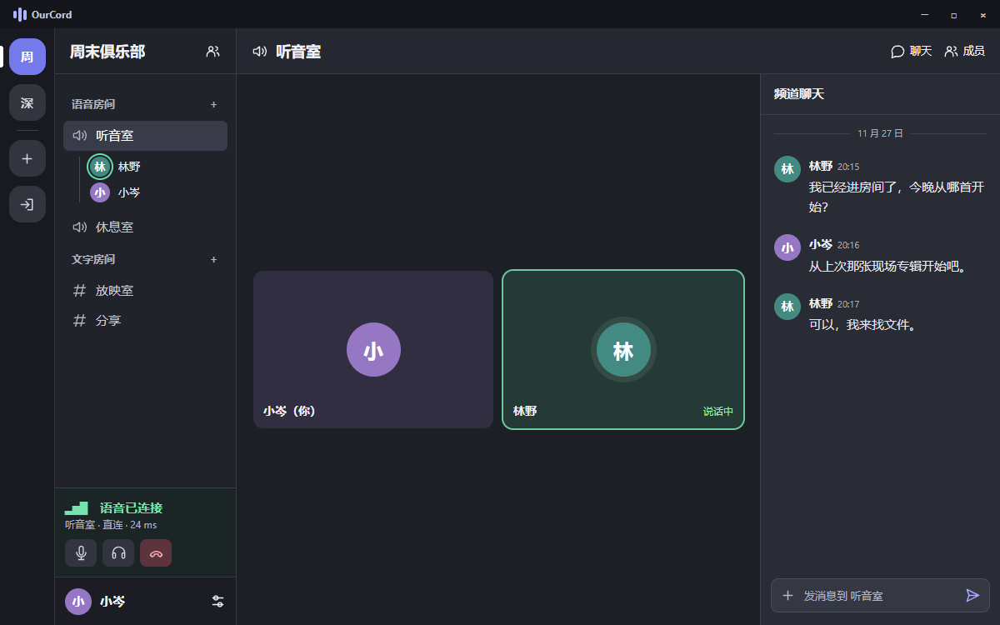
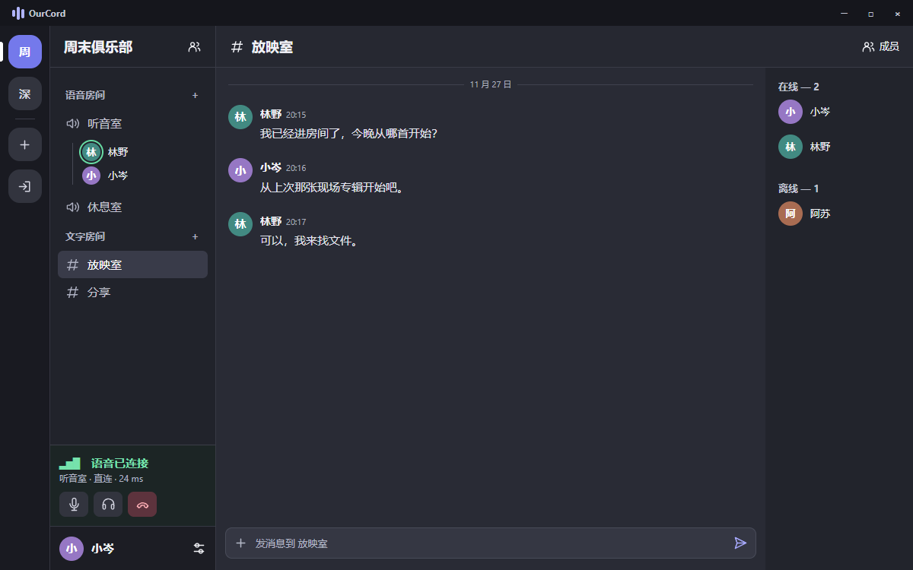
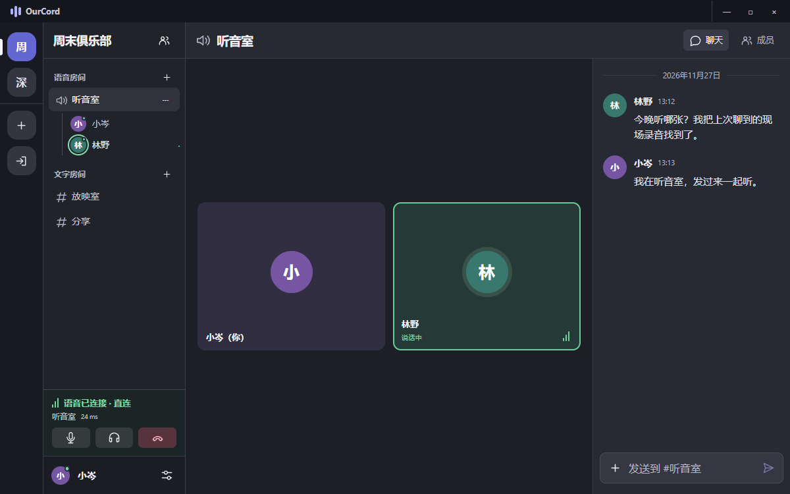

# OurCord 频道与语音设计稿

此次修订采用用户选择的 Discord 桌面导航习惯。服务器栏切换大厅，频道树分为语音和文字两个分组。进入语音房间后，中间显示参与者，右侧直接读写该语音房间的消息。切去文字频道时，左下方继续显示实际通话的房间、延迟与麦克风控制。[交互参考](https://support.discord.com/hc/en-us/articles/4412085582359-Text-Channels-Text-Chat-In-Voice-Channels)

## 设计图

[可编辑的两张画板](studio.html) 使用虚构的房间和成员。下图分别展示正在通话的语音房间与同一次通话中打开的文字频道。

## 交互和状态

- 大厅缩写与完整名称提示共存。频道图标区分文字和语音；频道下的名单显示当前参与者，正在发言的头像有绿色描边。
- 左下通话区域显示真实连接状态与房间名，提供麦克风、耳机和断开控制。点通话房间名称可回到该房间。
- 语音房的聊天与文字频道各自使用对应的房间 ID，切换时保留独立草稿；发言状态持续更新。聊天与成员面板按需切换。
- 达到最小宽度 920 px 时收紧导航和聊天栏，通话区、编辑框分别滚动。窗口操作、键盘焦点、登录、设置、诊断和确认弹窗使用同一套深色表面。
- 背景使用炭灰和蓝灰，活动语音使用绿色，离开通话使用红色，紫蓝用于主要操作。消息正文 15 px，导航和控制 13–15 px。色彩与图标、可访问名称和状态文字配合使用。

## 客户端实装

[920 × 620 最小窗口](voice-compact.png) · [文字频道实装](conversation-implemented.png)

截图来自 Chromium 中运行的桌面生产构建，使用模拟 Tauri IPC 提供房间、成员、消息和通话状态。验证涵盖在语音房发消息、切到成员列表、返回聊天、浏览其他频道以及恢复待发送草稿。语音房消息与文字房间消息分别以各自的房间 ID 发送。
